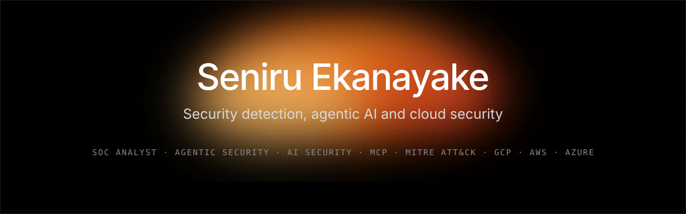
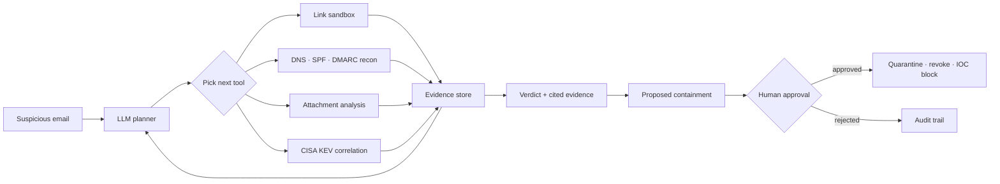
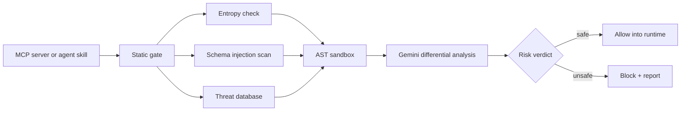

 

**Security analyst turned agentic-security engineer.**
I build AI agents that investigate threats, and security controls that keep AI agents honest.

 

  

<a href="#-snapshot"><b>SNAPSHOT</b></a> &nbsp;|&nbsp;
<a href="#-ground-truths"><b>GROUND TRUTHS</b></a> &nbsp;|&nbsp;
<a href="#-flagship-projects"><b>PROJECTS</b></a> &nbsp;|&nbsp;
<a href="#-how-i-secure-ai-agents"><b>AI SECURITY</b></a> &nbsp;|&nbsp;
<a href="#-capabilities"><b>CAPABILITIES</b></a> &nbsp;|&nbsp;
<a href="#-writing"><b>WRITING</b></a> &nbsp;|&nbsp;
<a href="#-contact"><b>CONTACT</b></a>

 

## ◼ Snapshot

<table>
<tr>
<td width="33%" valign="top">

**Now**

Cybersecurity Intern at **Scybers** (May 2026 to present). Working live **SIEM and EDR queues** in Microsoft Sentinel and Google SecOps: alert triage, intrusion investigation, MITRE ATT&CK mapping, incident documentation.

</td>
<td width="33%" valign="top">

**Building**

**Agentic security** systems: multi-agent threat detection on Google Cloud and Vertex AI, MCP server auditing, autonomous email investigation, and AI-assisted SOC automation with human approval gates.

</td>
<td width="33%" valign="top">

**Studying**

BSc (Hons) Computer Science, Software Engineering, University of Wolverhampton (CINEC Campus), 2023 to 2027. In progress: **Microsoft SC-200** (Security Operations Analyst) and **ISO/IEC 27001:2022**.

</td>
</tr>
</table>

 

## ◼ Ground truths

Numbers I can point to. Each one links to where it comes from.

<table>
<tr>
<td align="center" width="25%"><h3>275</h3>automated tests in FishingMails, including prompt-injection and SSRF cases <a href="https://github.com/seniru-ekanayake/agentic-email-defense">source</a></td>
<td align="center" width="25%"><h3>15 ms</h3>median rule-based email triage, offline live link + DNS checks under 0.6 s at p95 <a href="https://github.com/seniru-ekanayake/agentic-email-defense">source</a></td>
<td align="center" width="25%"><h3>F1 = 1.0</h3>Agent TICK adversarial evaluation on its own test set <a href="https://github.com/seniru-ekanayake/agent-TICK-Capstone-Project">source</a></td>
<td align="center" width="25%"><h3>7</h3>read-only investigation tools the email agent can plan with <a href="https://github.com/seniru-ekanayake/agentic-email-defense">source</a></td>
</tr>
<tr>
<td align="center"><h3>83%</h3>precision in active threat detection on ATT&amp;CK-aligned attack-path simulation</td>
<td align="center"><h3>85%</h3>accuracy of ISO 27001 / NIST CSF compliance reports vs. industry standards</td>
<td align="center"><h3>94%</h3>GRC dashboard accuracy against the standards it audits</td>
<td align="center"><h3>165</h3>Windows vulnerabilities found in a first deployment (45 critical, 120 medium)</td>
</tr>
</table>

Scope notes: the F1 score is from a self-built adversarial set, not an independent benchmark. FishingMails MTTR impact is still being measured with pilot data, so no MTTR figure is claimed.

 

## ◼ Flagship projects

<table>
<tr>
<td width="50%" valign="top">

### 🛡️ [FishingMails](https://github.com/seniru-ekanayake/agentic-email-defense)
**Agentic email threat investigation**

An autonomous investigator for phishing and business-email-compromise triage. An LLM planner picks its next step from read-only tools (link sandboxing, DNS and SPF/DMARC recon, attachment analysis, sender history, CISA KEV correlation), re-plans after every finding, and cites evidence for every point of risk. Containment (quarantine, session revoke, account disable, IOC blocking) is proposed, never executed without human approval.

`Python` `FastAPI` `Next.js` `MCP` `Docker` `Gmail / M365 / IMAP`

Multi-tenant RBAC · signed single-use approval tokens · full audit trail

</td>
<td width="50%" valign="top">

### 🔍 [Agent TICK](https://github.com/seniru-ekanayake/agent-TICK-Capstone-Project)
**Security meta-agent for MCP servers and agent skills**

Audits third-party tools before an AI runtime trusts them. Phase one is a static gate (Shannon entropy, schema injection scan, threat database). Phase two runs the tool in an AST sandbox and uses Gemini differential analysis to see whether adversarial requests can push the tool into unsafe behaviour. Catches tool poisoning, hidden exfiltration and dynamic-code RCE.

`Python` `Google ADK 2.0` `Vertex AI` `Cloud Run` `MCP`

MIT licensed · deployable on GCP Cloud Run

</td>
</tr>
<tr>
<td width="50%" valign="top">

### 🚨 [K.A.R.E.N. — AI SOC Analyst](https://github.com/seniru-ekanayake/AI-SOC-Analyst)
**Keen Analysis and Rapid Elimination Network**

A SOC platform that pairs rule-based detection with context-aware Gemini analysis. Events are enriched with asset criticality and user baselines, analysed asynchronously so detection never blocks, and an Active Defense module can terminate malicious processes on specific patterns such as brute-force bursts.

`Python` `Gemini` `Streamlit` `SQLite`

MIT licensed

</td>
<td width="50%" valign="top">

### 🔐 [Secure GenAI Gateway](https://github.com/seniru-ekanayake/secure-ai-gateway)
**Data loss prevention proxy for LLMs**

Sanitises PII, SPII and custom jargon locally before a prompt reaches a public model, then re-identifies the response. A bouncer layer blocks prompt injection and oversized input, and a JSON audit log records every masking decision (without storing the secrets) for GDPR, HIPAA and NIST evidence.

`Python` `Groq / Llama 3` `DLP` `Audit logging`

MIT licensed

</td>
</tr>
</table>

<b>More:</b> cloud infrastructure and AI guardrails

 

- **[aws-multi-region-failover](https://github.com/seniru-ekanayake/aws-multi-region-failover)**: Terraform for multi-region AWS failover, with a GitHub Actions deploy workflow.
- **[nemoclaw-chatbot](https://github.com/seniru-ekanayake/nemoclaw-chatbot)**: RAG security-policy chatbot on NVIDIA Nemotron (via OpenRouter) with NemoClaw guardrails.

 

### Architecture at a glance

FishingMails: plan, act, re-plan, then propose. Nothing destructive runs without a person approving it.

Agent TICK: a fast static gate first, then behavioural analysis for what signatures cannot see.

 

## ◼ How I secure AI agents

Agentic systems read documents, call APIs and install packages on their own. That moves the security boundary from the model to **what the model trusts**. These are the attacks I design and test against.

| Threat | What it looks like | Control I build | Where |
|:--|:--|:--|:--|
| **Tool poisoning / description injection** | Malicious instructions hidden in an MCP tool description or schema | Schema and description scan, entropy analysis, threat database | Agent TICK |
| **Semantic exfiltration** | Plain-English tool text that tricks the planner into sending `.env` data out; zero keywords, normal entropy | Behavioural sandbox and differential analysis, not signatures | Agent TICK |
| **Indirect prompt injection** | Untrusted content steering an agent's next action | Read-only tool sets, injection tests in CI, bouncer input validation | FishingMails, Gateway |
| **SSRF through agent tools** | Agent fetches an attacker-chosen internal URL | SSRF test cases and constrained link fetching | FishingMails |
| **Sensitive data leakage to LLMs** | PII or secrets sent to a public model | Local masking, re-identification, audit log | Secure GenAI Gateway |
| **Over-privileged autonomy** | Agent takes destructive action unprompted | Propose-then-approve, single-use signed tokens, full audit trail | FishingMails |
| **Package hallucination (slopsquatting)** | Agent installs a hallucinated dependency an attacker has registered | Verify package, owner and provenance before install | [Write-up](https://lnkd.in/p/guBJTzUJ) |

 

## ◼ Capabilities

<table>
<tr>
<td width="50%" valign="top">

**🧑‍💻 Security analyst / SOC**

Alert triage · SIEM analysis (Microsoft Sentinel, Google SecOps, Splunk) · EDR triage (Defender for Endpoint) · incident response · threat hunting · malware and network traffic analysis · MITRE ATT&CK mapping · Windows security events · Active Directory · incident timelines and SLA documentation

</td>
<td width="50%" valign="top">

**🤖 Agentic AI and AI security**

Multi-agent orchestration · Model Context Protocol (MCP) · Google ADK · LangGraph · LangChain · Vertex AI · Ollama (local LLMs) · explainable AI for security · prompt-injection defense · LLM guardrails · tool-integrity auditing · AI governance (ISO/IEC 42001)

</td>
</tr>
<tr>
<td width="50%" valign="top">

**☁️ Cloud security**

Google Cloud (Cloud Run, Vertex AI, SecOps) · Microsoft Azure and Entra ID · AWS · Terraform and infrastructure as code · multi-region resilience · cloud security telemetry · least-privilege design · compliance as evidence (ISO 27001, NIST CSF)

</td>
<td width="50%" valign="top">

**🧪 Offensive and validation skills**

Vulnerability assessment · Burp Suite · Nmap · Metasploit · Wireshark · fuzzing and code review · responsible disclosure write-ups · Atomic Red Team simulation · Hack The Box · LetsDefend blue-team scenarios · CTFs

</td>
</tr>
</table>

 

 

## ◼ Certifications

| | Credential |
|:--|:--|
| ✅ | Google Cybersecurity Professional Certificate |
| ✅ | Microsoft Azure Fundamentals |
| ✅ | Splunk Academy: Fundamentals and Junior Analyst |
| ✅ | Gemini Enterprise Certified Partner Specialist (Deployment and Agent Development) |
| ✅ | Agentic Coding Assistant and Prompt Engineering for Developers (DeepLearning.AI) |
| ✅ | EC-Council OSINT Certificate |
| 🔄 | Microsoft SC-200: Security Operations Analyst Associate (in progress) |
| 🔄 | ISO/IEC 27001:2022 Awareness (in progress) |

 

## ◼ Writing

Notes on agentic security, detection and AI risk, posted on [LinkedIn](https://www.linkedin.com/in/seniru-ekanayake/).

| Post | Topic |
|:--|:--|
| [Your SOC analyst opens a suspicious email. What if the investigation was already finished?](https://lnkd.in/p/geCkPgKH) | Autonomous email investigation, evidence-cited verdicts |
| [OWAReaper: what if opening an email was enough to lose your mailbox?](https://lnkd.in/p/gbSe9RKq) | Agent architecture for email-borne attacks |
| [Slopsquatting: your AI can now hallucinate dependencies](https://lnkd.in/p/guBJTzUJ) | AI supply-chain risk |
| [The next AI attacks won't target the model, they'll target what it trusts](https://lnkd.in/p/gTmZtp-p) | MCP and the agent trust boundary |
| [Why traditional code scanners fail against semantic threats](https://lnkd.in/p/gb8fcrcw) | Indirect prompt injection, Agent TICK |
| [OpenRouter Fusion: the mixture-of-agents pattern as a single API call](https://lnkd.in/p/gqfzwM7P) | Multi-model agent orchestration |

 

## ◼ Experience and education

<table>
<tr>
<td width="50%" valign="top">

**Cybersecurity Intern, Scybers**
*May 2026 to present*

- Monitor events across Google SecOps and Microsoft Sentinel
- Triage SIEM alerts and EDR endpoints, escalate critical incidents
- Investigate intrusions; exploit analysis of malware and suspicious traffic
- Categorise threats with MITRE ATT&CK
- Build multi-agent detection systems on GCP and Vertex AI

</td>
<td width="50%" valign="top">

**BSc (Hons) Computer Science, Software Engineering**
*University of Wolverhampton, CINEC Campus, 2023 to 2027*

- ISO 27001-aligned risk assessment and reporting
- Enterprise control evaluation and hardening
- GRC dashboard and audit evidence documentation
- Hack The Box, LetsDefend, CTFs, Atomic Red Team

</td>
</tr>
</table>

 

## ◼ Contact

I'm open to **SOC analyst, detection engineering, cloud security and agentic-AI security** roles and collaborations.

  

Kurunegala, Sri Lanka · security analyst · agentic AI security · cloud security · AI security · detection engineering

